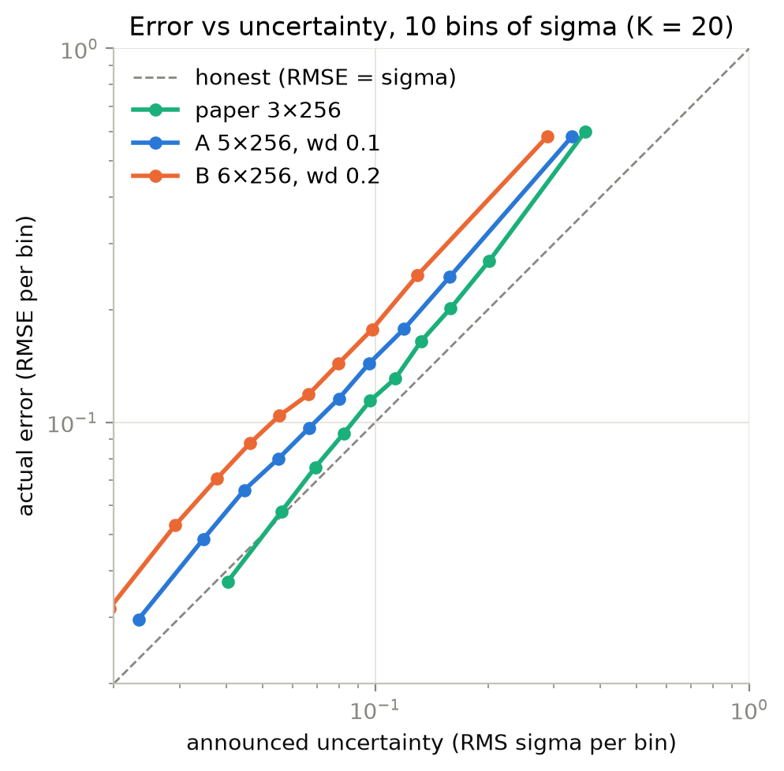

# constellaration-surrogate-uq

**Does a ConStellaration surrogate know when it is wrong?**

Stellarator design relies on optimisers that query a physics code thousands of times. A neural-network
*surrogate* can replace that code (milliseconds instead of minutes per shape), but an optimiser is built to
explore shapes it has never seen, which is exactly where a surrogate is least reliable. This project measures
whether the **uncertainty** a surrogate reports actually tracks its **error**, in particular out of
distribution (OOD).

It builds on the open [ConStellaration](https://arxiv.org/abs/2506.19583) dataset and benchmark released by
Proxima Fusion ([dataset](https://huggingface.co/datasets/proxima-fusion/constellaration),
[code](https://github.com/proximafusion/constellaration)).

> **Status (November 2026): work in progress.** Data pipeline, exploration, the baseline surrogate and its
> uncertainty on the random split are done; out-of-distribution splits and other uncertainty methods are next. Numbers below come from the notebooks, `results/` and `analysis/` in this
> repository.

## The problem in one picture

```
shape of the plasma boundary          forward model                      12 metrics
(81 Fourier coefficients + NFP)  ──►  VMEC++ equilibrium + post-processing ──►  (aspect ratio, rotational transform,
                                      (minutes per shape)                     mirror ratio, QI residual, ...)
            │                                                                       ▲
            └──────────────── surrogate: an ensemble of neural networks ────────────┘
                              (milliseconds; trained on ~27k computed shapes)
```

- **Inputs:** the plasma boundary, a 3D surface written as a Fourier series
  $R=\sum r_{\cos}(m,n)\cos(m\theta-N_{fp}n\varphi)$, $Z=\sum z_{\sin}(m,n)\sin(m\theta-N_{fp}n\varphi)$,
  with 81 coefficients that actually vary, plus the number of field periods $N_{fp}$.
- **Outputs:** the 12 metrics of the official forward model (`constellaration/forward_model.py`),
  with $\log_{10}$ applied to the QI residual.
- **Question:** when the surrogate is wrong, does its predicted uncertainty say so?

## Why it matters: the target region is outside the data

The benchmark problem *SimpleToBuildQIStellarator* defines 5 feasibility constraints
($A \le 10$, $|\iota_{edge}|/N_{fp} \ge 0.25$, $\log_{10} qi \le -4$, edge mirror ratio $\le 0.2$,
max elongation $\le 5$). **None of the 26,746 shapes of the paper's baseline subset satisfies all of
them**: the best $\log_{10} qi$ is −3.42. An optimiser guided by a surrogate therefore *has* to
extrapolate, and it needs to know when the surrogate stops being trustworthy.

## Progress

| step | status |
|---|---|
| Download the dataset, flatten the Fourier matrices, build ML-ready tables | done |
| Shared cleaning and paper-baseline filter (`src/data.py`) | done |
| Exploration: rotational transform, generation methods, failures, targets (notebooks 01, 02) | done |
| OOD splits defined and their distance to the training set measured | done |
| Reproduce the paper's surrogate: ensemble of MLPs (3 × 256, tanh) | done |
| Hyperparameter search, run-to-run noise, final 20-network ensembles ([details](analysis/model_selection.md)) | done |
| Uncertainty metrics on RAND: NLL, 90/95 % coverage, interval width, uncertainty–error correlation | done |
| Compare deep ensemble, MC Dropout, conformal prediction (GP optional) on every split | planned |
| Final figures, results and limitations in this README | planned |

## Findings so far (data exploration)

- **182,222 shapes, 158,685 with metrics.** Metrics are missing all-or-nothing: when the forward model
  fails, none of the 12 metrics exists. Failure rate per generation method: NAE initialisations 36.0 %,
  VMEC optimisations 35.8 %, QP initialisations 1.1 %, DESC optimisations ~0 %.
  The surrogate is therefore only ever trained on shapes for which the physics code converged.
- **Four generation methods, four very different shape distributions.** QP and NAE initial guesses use
  only 10 and typically 9 non-zero Fourier coefficients; DESC and VMEC optimisations use all 81.
- **Paper baseline subset:** NFP = 3, DESC or VMEC, 0.05 % tails trimmed per metric. We obtain
  **26,746 shapes vs ~23k reported in the paper.** The gap appears before tail trimming
  (27,050 DESC/VMEC shapes at NFP = 3), with no error flags and almost no duplicates; its cause is unknown.
  Reading "0.05 %" as per end or in total changes the count by 0.6 % only.
- **Consistency checks against the official code:** the stored $A/\iota_{edge}$ equals the aspect ratio
  divided by the *total* edge rotational transform (stored per-period value × $N_{fp}$) on all 158,685 rows,
  to machine precision (max relative error $3\times10^{-16}$).
- **Rotational transform:** 6.4 % of the configurations have a negative $\iota$ (sign = twist direction,
  never changes between axis and edge); in 39 % of them $|\iota|$ decreases from axis to edge.
  Only 35.7 % satisfy $|\iota_{edge}|/N_{fp} \ge 0.25$, from 52 % at NFP = 3 to 15 % at NFP = 4–5.

## Baseline surrogate (RAND split)

Each surrogate is an ensemble of 20 MLPs (tanh, AdamW, early stopping on a validation set), trained on the
paper's baseline subset with a random 80/20 split (19,258 training, 2,139 validation, 5,349 test shapes).
Inputs and targets are z-scored, so an MSE of 1 means "no better than predicting the mean".

| model | architecture | weight decay | validation MSE | test R², 11 metrics | test R², gradient scale length |
|---|---|---|---|---|---|
| paper reproduction | 3 × 256 | 0 | 0.0508 | 0.936 – 0.990 | 0.757 |
| **A (reference)** | 5 × 256 | 0.1 | **0.0449** | 0.945 – 0.992 | 0.759 |
| B (comparison) | 6 × 256 | 0.2 | 0.0457 | 0.943 – 0.993 | 0.756 |

- **A deeper, regularised network is 12 % better than the paper's architecture** on validation, far above the
  measured run-to-run noise (≈ 0.001), and better on 11 of the 12 test metrics (6.5 to 15 % lower RMSE).
- **A and B are statistically indistinguishable** (5 seeds each at $K = 3$: 0.0493 ± 0.0008 vs
  0.0485 ± 0.0010, difference 1.5 standard errors). A is the reference because it is smaller; B is kept because
  its networks disagree less with each other, which should give narrower uncertainty intervals.
- **The remaining error is bias, not variance:** fitting $	ext{MSE}_K = a + b/K$ gives a floor $a = 0.044$
  for A, so adding networks beyond 20 would not help.
- **We do not reach the paper's reported accuracy** ($R^2 > 0.97$ for every metric). The minimum normalised
  magnetic gradient scale length stays at $R^2 pprox 0.76$ for every architecture tried: it is a minimum over
  the surface, which can jump when its location moves.

How these models were chosen, with every table and every calculation (noise measurement, thresholds,
statistical tests): [`analysis/model_selection.md`](analysis/model_selection.md)
([PDF](analysis/model_selection.pdf)).

## Uncertainty on the RAND split

Does the ensemble know when it is wrong? Each ensemble predicts the mean of its 20 networks and uses their
standard deviation σ as uncertainty. Measured on the 5,349 test shapes ([notebook 03](notebooks/03_uq_rand.ipynb),
`src/uq_metrics.py`):

| K = 20 | paper | A | B |
|---|---|---|---|
| RMSE (z-scored, mean of 12 targets) | 0.214 | **0.197** | 0.198 |
| coverage of the 90 % interval | **0.867** | 0.793 | 0.705 |
| std of (y − μ) / σ (ideal 1) | **1.18** | 1.44 | 1.80 |
| Spearman(σ, \|error\|) | 0.514 | **0.521** | 0.501 |



- **σ ranks the shapes correctly:** the error rises steadily with σ for all three models, so the surrogate
  knows *where* it is likely to be wrong.
- **σ is too small:** all ensembles are over-confident. The ensemble only sees the disagreement between its
  networks, not the error they share; weight decay makes the networks agree more than it makes them right,
  so the more accurate models (A, B) are the less honest.
- **The errors are heavy-tailed:** most errors are smaller than σ, a few are much larger (calibration curves in
  [figures/](figures/uq_rand_calibration.png)), so rescaling σ by a single factor will not be enough everywhere.
- **More networks help the uncertainty, not the prediction:** coverage still rises between 10 (the paper's
  choice) and 20 networks.
- **Next:** recalibration and conformal prediction fitted on the validation set, then the same metrics on the
  out-of-distribution splits.

## Out-of-distribution splits

The paper evaluates its surrogate on a random 80/20 split only. The splits below are ours; for each one we
measure the distance from test shapes to their nearest training shape (standardised Fourier coefficients)
to know *what kind* of shift it is.

| code | train on | test on | type of shift (measured) | test size |
|---|---|---|---|---|
| **RAND** | random 80 % of the baseline subset | remaining 20 % (repeated ~20×) | none: reference | 5,349 |
| **FEAS** | 90 % of the baseline subset furthest from feasibility | 10 % closest to the feasible region (also 5 % and 20 %) | outputs: extreme metrics, familiar shapes | 2,675 |
| **INIT** | baseline subset (DESC + VMEC) | QP / NAE initial guesses, NFP = 3 | outputs: shapes close in input space, different metrics | 41,141 |
| **NFP4** | baseline subset (NFP = 3) | DESC / VMEC shapes with NFP = 4 | relation: same coefficients describe another machine | 22,772 |
| **FAIL** | models trained for RAND | shapes on which the physics code failed, NFP = 3 | inputs: 23 % of them further than 95 % of RAND test shapes | 13,852 |

FAIL has no ground-truth metrics: it is evaluated as a detection task (is the predicted uncertainty higher on
shapes that would crash the real code? AUROC). Each result will be compared with the spread of the RAND
repetitions, with bootstrap confidence intervals.

## Repository layout

```
src/
  download_dataset.py   download the 'default' subset from Hugging Face, build data/processed and data/sample
  data.py               shared cleaning, paper-baseline filter; `python src/data.py` caches the filtered subset
  inspect_parquet.py    inspect parquet files: schema, row counts, missing values, size on disk
  train_baseline.py     train an ensemble of MLPs on the RAND split; saves metrics, predictions and a training log
  uq_metrics.py         score the uncertainty of trained ensembles (coverage, width, NLL, z-std, Spearman, calibration)
notebooks/
  01_iota_exploration.ipynb      rotational transform: shear, A/iota consistency, benchmark constraint
  02_dataset_exploration.ipynb   methods x NFP, failures, baseline subset, targets, inputs, OOD splits
  03_uq_rand.ipynb               calibration of the ensembles on the RAND split (figures in figures/)
analysis/
  model_selection.md    how the baseline surrogate was chosen, with all calculations (also as PDF)
figures/                figures used in this README
results/                metrics (.csv) and training logs (.json) of every run; predictions (.npz) are git-ignored
data/                   (git-ignored) raw shards, processed table, samples
```

## Reproduce

Requires [uv](https://docs.astral.sh/uv/) and Python ≥ 3.14.

```bash
uv sync                                    # install the locked environment
uv run python src/download_dataset.py      # ~610 MB download, builds data/processed/constellaration.parquet
uv run python src/data.py                  # optional: cache the paper-baseline subset
```

Then open the notebooks in `notebooks/` with the `.venv` kernel. To train the three final surrogates
(about 20 min to 1 h each on a laptop CPU):

```bash
uv run python src/train_baseline.py --n-members 20 --depth 5 --width 256 --weight-decay 1e-1 --tag _A_final
uv run python src/train_baseline.py --n-members 20 --depth 6 --width 256 --weight-decay 2e-1 --tag _B_final
uv run python src/train_baseline.py --n-members 20 --tag _paper
```

Random operations use fixed seeds: rerunning a command on CPU gives the same numbers.

## Known limitations

- The `method` label is derived from which optimisation-settings column is filled, with priority
  DESC > VMEC > QP > NAE. This is our rule, not the dataset's.
- INIT only contains initial guesses for which the physics code succeeded; with a 36 % failure rate for NAE,
  its test set is biased towards "easy" NAE shapes.
- In NFP4, NFP is constant during training, so the model cannot learn its effect: the split measures how a
  model behaves when the input–output relation changes, not a generalisation in NFP.
- Hyperparameters were searched on depth, width, dropout and weight decay only, about 25 settings on one
  validation set; learning rate, batch size and activation were not tuned.
- The nearest-neighbour distance is a Euclidean distance in 81 dimensions; it says nothing about which
  coefficients matter physically.

## References

- S. A. Cadena, A. Merlo, et al., *ConStellaration: A dataset of QI-like stellarator plasma boundaries and
  optimization benchmarks*, NeurIPS 2025, [arXiv:2506.19583](https://arxiv.org/abs/2506.19583).
- Dataset: [proxima-fusion/constellaration](https://huggingface.co/datasets/proxima-fusion/constellaration) on Hugging Face.
- Code: [proximafusion/constellaration](https://github.com/proximafusion/constellaration).

## Author

Mathieu Piekarz, engineering student at UTC.
